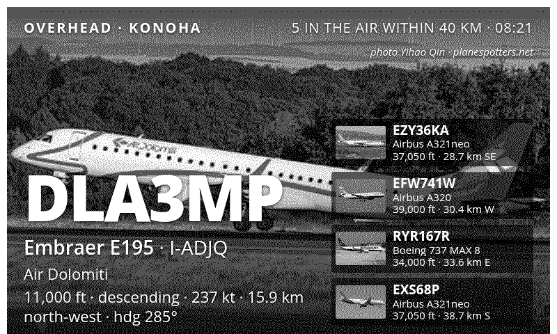
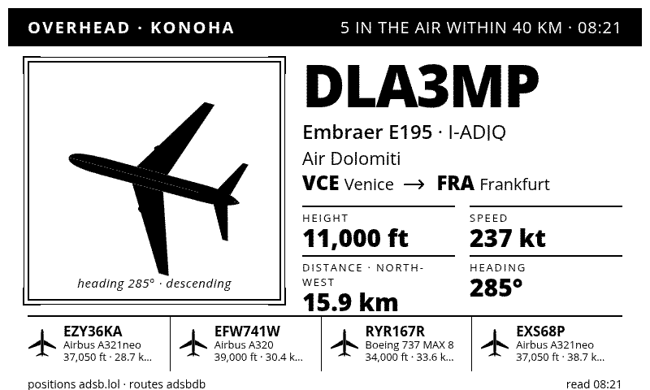
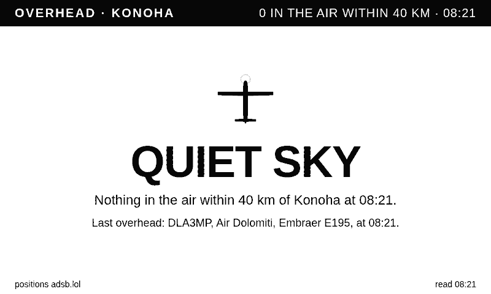

# Overhead, for TRMNL

The aircraft over your home right now, on a TRMNL e-ink screen.

The nearest one is drawn large, with its photograph from planespotters.net when one exists, its callsign, type, registration, operator, route, height, speed, distance with compass direction and heading. The next four sit along a strip. When no photograph exists the airframe is drawn as a silhouette rotated to its track, in a ruled plate. An empty sky says "QUIET SKY" and remembers what passed last. A feed that does not answer says so.

A port of [dmellok/tesserae-widget-overhead](https://github.com/dmellok/tesserae-widget-overhead) (its Photo and Plate pages) to a TRMNL Recipe. The widget's aircraft type and operator tables, its page logic and its silhouettes are carried over; see [ATTRIBUTION.md](ATTRIBUTION.md).

## Looks

| | |
|---|---|
| Photo, TRMNL OG | Plate, TRMNL OG |
|  |  |
| Photo, TRMNL X portrait | Quiet sky |
|  |  |

## Install

**From the TRMNL Recipes catalogue** once it is published: install, set your home, done.

**As a private plugin** on any TRMNL account with the Developer add-on or a BYOD licence:

1. Install [trmnlp](https://github.com/usetrmnl/trmnlp) and `trmnlp login` with your API key.
2. Clone this repository and run `trmnlp push` inside it. It creates the private plugin with the markup, the settings and the Serverless transform.
3. Open the plugin on trmnl.com, fill in your home, and add it to a playlist.

**On [kuroshiro](https://github.com/PhyberApex/kuroshiro)** (a self-hosted TRMNL server): import the repository as a Recipe from the Plugins page. Its lone Data Source reads at the root, its transform keeps Saved State and fetches, so everything works the same.

`trmnlp serve` previews the plugin locally; `.trmnlp.yml` holds the Form Field values the preview uses, with a home you will want to change.

## Settings

| Field | What it does |
|---|---|
| Home | The point the sky is watched from. TRMNL's location picker turns a city or address into coordinates. |
| Place name | How the header names your home. |
| Radius (km) | How far out counts as overhead. 40 km is a good start; a busy approach wants less. |
| Aircraft on the ground | Whether taxiing aircraft at a nearby airport count. |

## How it works

One Polling URL asks [adsb.lol](https://adsb.lol) for every aircraft within the radius of your home. The Serverless `run(input)` sorts them by distance, names each one's type and operator from the tables, works out bearing and compass direction, and keeps the nearest five.

Where the sandbox has `fetch` (TRMNL Serverless, kuroshiro), it then asks [adsbdb](https://www.adsbdb.com) for each callsign's route and [planespotters.net](https://www.planespotters.net/photo/api) for a photograph of the very airframe, by registration. Each answer, including "none", is kept in Saved State (`trmnl_state`) for the next refresh, so a regular over your house costs one lookup, ever. The state is trimmed to stay under TRMNL's 8 KB. Without `fetch` the transform answers synchronously and the page draws silhouettes.

Photographs are credited to their photographer on the screen and are fetched by your device from planespotters' image host; nothing is stored. The planespotters API asks for a contact in the User-Agent, which the transform sends as this repository's URL.

## Layout

The markup is one `full` view. It answers the TRMNL OG (800×480, 2-bit or 1-bit) and the TRMNL X through the framework's `screen--lg` and `screen--portrait` classes, with the strip stacking above the hero text and the plate above its note in portrait.

## Licence

AGPL-3.0-or-later, as the widget it is ported from. See [LICENSE](LICENSE).
